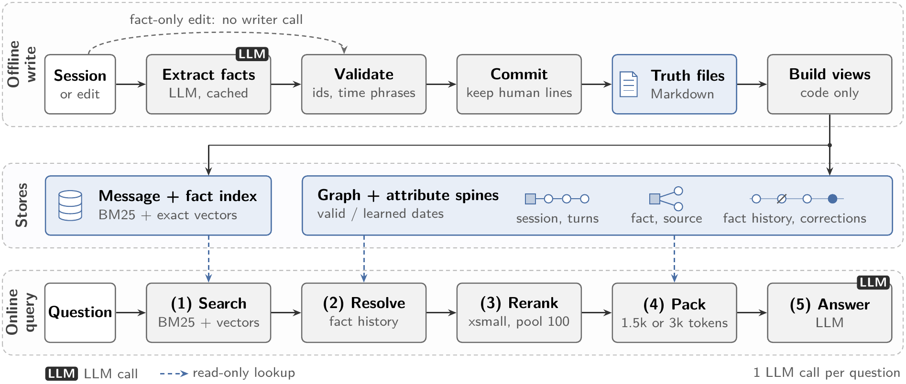

# SpinalMemory

Efficient long-term memory for LLM assistants through graph search.



## Install

```sh
git clone https://github.com/CedricKhuaYanHan/spinalmemory.git
cd spinalmemory
pip install -e .
```

## Use

```python
from spinalmemory import Answerer, build_store, load_config

cfg = load_config()
handle, _ = await build_store(history, cfg)   # writer LLM, once per session, cached
answerer = Answerer(cfg)

memory = answerer.recall("What is Priya's dog called?", handle)   # no LLM call
memory.context   # packed memory, ready for any model

result = await answerer.answer({"question_id": "q1", "question": "What is Priya's dog called?"}, handle)
```

See [docs/architecture.md](docs/architecture.md) for the input format and how it works.

## Providers

Anthropic, OpenAI or any OpenAI-compatible server (vLLM, Ollama, LM Studio):

```sh
export SPINE_LLM_PROVIDER=openai_compatible
export SPINE_LLM_MODEL=qwen3:8b
export SPINE_LLM_BASE_URL=http://localhost:11434/v1
```

Other settings are in [configs/default.toml](configs/default.toml).

## Tests

```sh
pip install -e '.[test]' && pytest -q
```

## Licence

Apache-2.0. Copyright 2026 Cedric Khua.
