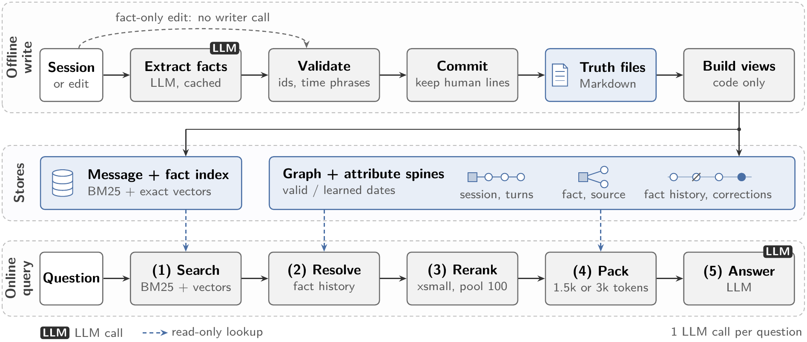

# Architecture

Spine keeps everything it knows in Markdown truth files and derives every index from them by code. A question
costs at most one LLM call: `recall` makes none and `answer` makes one. The writer runs once per session at
build time.



## Truth files (`truth.py`)

One file per session, `sessions/<slug>.md`: front matter with the session id and date, then one block per turn.

```
### D3:1
speaker: Priya
role: speaker
> Hi Tom! I joined a pottery class yesterday.
- m | Priya joined a pottery class yesterday. | Priya | hobby | pottery | "yesterday"
- h | Priya lives in Leeds. | Priya | lives_in | Leeds | @2022 | also: D1:3
```

- Turn ids are stable and never renumbered. Turn text is quoted with `> `, so any text round-trips.
- A fact line is `tag | sentence | subject | attribute | value | when [| also: <turn ids>]`.
- `m` lines are written by the writer and replaced on re-ingest. `h` lines are written by a person and always
  kept.
- `when` is a quoted time phrase from the turn (resolved by code), a human-set date `@YYYY[-MM[-DD]]`, or `-`.
- `also:` lists further source turns, so facts and turns are many-to-many.

## Write path (`write/`)

| Step | Module | What it does |
| --- | --- | --- |
| Append | `append.py` | history -> session files with stable turn ids |
| Window | `windows.py` | one session per writer call, short ids `t1..tn`; user turns only for user/assistant histories |
| Writer | `writer.py` | one LLM call per window, cached by a hash of the exact request (provider and model included); retried once if validation fails |
| Validate | `validate.py` | known ids, five fields, closed attribute vocabulary or `other:<name>`, time phrases that occur in the turn, at most 3 lines per turn |
| Commit | `commit.py` | new `m` lines plus the existing `h` lines |
| Build | `build.py` | writes the files, then projects the store |
| Edit | `edit.py` | a fact-only edit re-projects with no writer call; a turn edit re-ingests that session once |

The writer never sees the session date. Dates are resolved by code.

## Projection (`project/`)

The projection is a pure function of the truth files and pinned inputs (date resolver, attribute vocabulary,
alias rules, encoder id, budget tokenizer). A full build is an incremental update from an empty state, so any
sequence of edits gives the same canonical dump as a cold rebuild.

- `timeexpr.py`: a deterministic resolver from time phrases to date intervals, anchored on the session date.
- `entities.py`: name normalisation, first person mapped to the speaker, and `alias` facts merged by union-find.
- `vocab.py`: the attribute vocabulary, split into single-valued (one current value) and multi-valued.
- `projection.py`: turns, facts, entities, resolved dates, attribute spines, FTS5 tables, and per-turn index text
  and rendered token costs.
- `vectors.py`: `BAAI/bge-base-en-v1.5` embeddings in fp32, cached in SQLite by model revision and text, and the
  cross-encoders. Revisions are pinned.

**Person spines.** For each (person, attribute) pair, the facts in newest-first order: valid date if known, else
learned date, then learned date, then a hash of the fact id. Single-valued attributes have a current head.
**Correction rule:** an `h` line with the same person and attribute as an `m` line, citing the same turn, with a
different value, corrects it. The corrected line leaves the head, the index text and the rendered facts, and is
shown only as "replaced". An `h` line with the same value confirms the `m` line and is shown once.

## Query path (`query/`, `answer.py`)

1. **Parse** (`parse.py`): named persons, the partition (user turns for user/assistant histories, unless the
   question asks about what the assistant said), the question date, and flags for counting, temporal and advice
   questions.
2. **Search** (`retrieve.py`): BM25 and exact cosine over the partition, plus the named persons' turns, fused
   with RRF (`k = 60`). Ties break on a hash of the id.
3. **Resolve** (`history.py`): facts cited by the top 20 turns seed the check. Spines of the matching persons
   with at least 2 members add their source turns (at most 20) to one pool of 100.
4. **Rerank** (`retrieve.py`): `mixedbread-ai/mxbai-rerank-xsmall-v1` scores the pool.
5. **Size** (`budget.py`): 1,500 memory tokens if the top score leads the 10th by at least 1.99, else 3,000.
6. **Pack** (`pack.py`): whole turns in reranker order, greedy, with session headers charged once. The block is
   rendered and counted exactly, and the plan is adjusted until it fits close to the budget. The rendered block
   never exceeds it.
7. **Render** (`render.py`, `temporal.py`, `advice.py`): a fact-history section, then sessions oldest first with
   dates resolved next to relative time phrases, then human fact lines under their turns. Questions with their
   own date get dates relative to the question date and a short Notes line. Advice questions get an instruction
   to tailor one suggestion.
8. **Recall** (`answer.py`): `Answerer.recall` stops here and returns a `Recall`: the memory block, its token
   count and budget, the packed passages and their fact lines, and the full prompt. No LLM call.
9. **Answer** (`answer.py`, `llm.py`): `Answerer.answer` runs recall, then one call. A retry after a request that
   may have reached the API raises `OneCallViolation` and sends nothing. The Answer and Evidence lines are parsed
   by code.

## LLM (`llm.py`)

One HTTP request per call, through httpx, to one of three providers: `anthropic` (Messages API), `openai` or
`openai_compatible` (chat completions at `{base_url}/chat/completions`, for vLLM, Ollama, LM Studio, llama.cpp,
LiteLLM and similar). `llm.settings(cfg, role)` resolves the provider, model and base URL for the writer or the
answer call: environment, then `[llm.writer]` or `[llm.answer]`, then `[llm]`. Keys are read from the environment
at request time and never stored. Usage is normalised to input, cached and output tokens for every provider.

## Settings

All settings live in `configs/default.toml`; the README lists them. The `[build]` section, the writer's provider
and model, and the fingerprint of the store-shaping code form the build key (`config.build_key`), and stores live
under `stores/<build key>/`. Query settings and the answer model can change without a rebuild.

Token budgets use the Qwen3.6 tokenizer (`mlx-community/Qwen3.6-35B-A3B-4bit`, tokenizer files only), so a budget
is a fixed amount of text whichever model answers.
